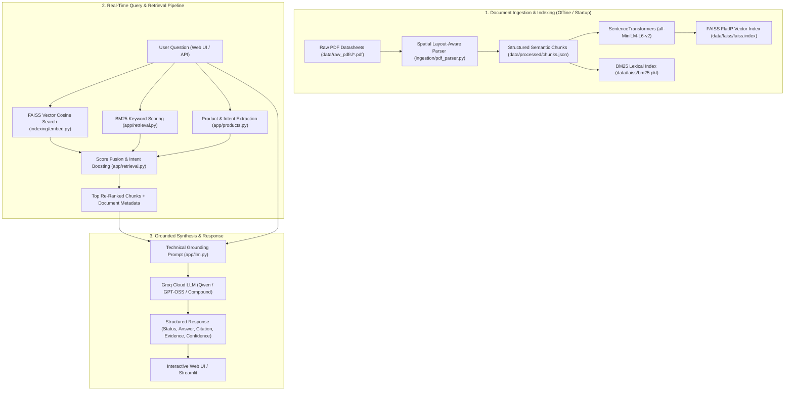

# Lighting Technical Sales RAG Assistant - Architecture & Workflow Guide

An end-to-end guide explaining the architecture, data ingestion pipeline, hybrid retrieval mechanism, LLM grounding, and API/UI workflow.

---

## 1. System Architecture Overview

The system is a **Retrieval-Augmented Generation (RAG)** pipeline specifically optimized for technical specification datasheets.



---

## 2. Step-by-Step Workflow Explanation

### Step 1: Document Ingestion & Spatial Layout Parsing
- **Input**: 13 technical product datasheets in `data/raw_pdfs/`.
- **Challenge**: Commercial lighting datasheets feature multi-column layouts with dense tables. Traditional line-by-line parsers scramble column values (e.g. associating wattage with beam angles).
- **Solution (`ingestion/pdf_parser.py`)**:
  1. Uses PyMuPDF (`fitz`) to extract text blocks along with spatial bounding boxes `(x0, y0, x1, y1)`.
  2. Divides page content into left and right columns.
  3. Uses **vertical proximity pairing** to pair each specification label (e.g., `Beam Angle:`) with its exact corresponding value block (e.g., `15°, 24°, 36°`).
  4. Automatically aliases technical abbreviations (`CCT`, `CRI`, `IP Rating`, `IK Rating`, `Wattage`, `Lumens`).
  5. Partitions each datasheet into distinct semantic chunks:
     - **Overview & Description**: Product summary, key benefits, recommended application areas.
     - **Specifications**: Power consumption, luminous flux, CCT, CRI, SDCM, beam angles, input voltage, frequency, power factor, dimming, temperature.
     - **Mechanical & Compliance**: Housing materials, finishes, IP/IK protection codes, safety classes, certifications.
     - **Dimensions**: Cutout sizes `C (mm)` and housing dimensions `DxH (mm)` per wattage variant.
     - **Master Datasheet**: Complete consolidated product specification sheet.

---

### Step 2: Index Construction
- **Vector Embeddings (`indexing/faiss_index.py`)**:
  - Encodes chunk texts using `sentence-transformers/all-MiniLM-L6-v2`.
  - Normalizes embeddings to unit length for exact Inner Product (cosine similarity) search.
  - Builds and saves `data/faiss/faiss.index` and `data/faiss/chunks_ref.pkl`.
- **Lexical BM25 Index (`indexing/bm25_index.py`)**:
  - Tokenizes texts and applies stopword suppression (filtering out conversational terms like *what, is, the, of, for*).
  - Preserves domain terminology (`beam`, `angle`, `cct`, `triac`, `dali`, `ip40`, `die-cast`).
  - Builds and saves `data/faiss/bm25.pkl`.

---

### Step 3: Hybrid Retrieval & Re-ranking (`app/retrieval.py`)
When a user submits a question:
1. **Metadata Matching**: `identify_product_metadata()` checks if a specific product (e.g., *BrightSpace*, *LuxSpace*, *LaserLux*) is mentioned using word-boundary matching.
2. **Dual-Path Search**:
   - **FAISS Semantic Search**: Computes dense vector similarity between the query embedding and all indexed chunk vectors.
   - **BM25 Lexical Search**: Computes keyword match scores against chunk token indexes.
3. **Intent-Based Score Fusion**:
   - Computes weighted score: `(0.45 * Dense_Score) + (0.55 * BM25_Score)`.
   - **Product Boost**: Adds `+0.35` boost to chunks matching the target product.
   - **Intent Routing Boost**: Adds `+0.25` boost to chunks matching the question type (e.g., boosting `specifications` chunks for metric queries, `dimensions` chunks for size queries, and `overview` chunks for application queries).
   - **Keyword Match Boost**: Adds additional weight for exact term co-occurrences.
4. Returns the top `k=6` candidate chunks.

---

### Step 4: Grounded Response Generation (`app/llm.py`)
1. Formats the top candidate chunks into numbered context blocks with document name, page number, product family, and section type.
2. Sends the context and user query to the **Groq LLM Engine**:
   - Primary high-speed model: `qwen/qwen3.8-27b` (~0.4s latency).
   - Fallback models: `openai/gpt-oss-120b`, `groq/compound`.
3. **Prompt Directives**:
   - Strict factual grounding (only answer using provided context).
   - Strict unit matching (e.g., degrees `°` for beam angles, Kelvin `K` for CCT, Watts `W` for power, Lumens `lm` for luminous flux, `IPxx` for ingress protection, `years` for warranty).
   - Handles single specs, multi-spec queries, comparison questions, and application recommendations.

---

### Step 5: Presentation & API Output (`app/main.py`)
Returns a structured JSON payload (`QueryResponse`):
- `status`: `"FOUND"` or `"NOT_FOUND"`
- `natural_response`: Markdown formatted direct answer.
- `product`: Identified product family name.
- `specification`: Detected specification category.
- `source`: Document file name (e.g., `BrightSpace.pdf`) and page number (e.g., `1`).
- `evidence`: The exact raw text chunk used for verification.
- `confidence`: Confidence score (0.0 to 1.0).

---

## 3. Directory Structure

```
sales-rag/
├── app/                        # Application Core
│   ├── main.py                 # FastAPI backend & endpoints
│   ├── retrieval.py            # Hybrid search (FAISS + BM25 + Intent Boosting)
│   ├── llm.py                  # Groq LLM integration & technical prompt
│   ├── products.py             # 13 Product catalog & metadata identification
│   └── schemas.py              # Pydantic request/response schemas
├── ingestion/                  # Ingestion Pipeline
│   ├── pdf_parser.py           # Spatial layout-aware PDF coordinate parser
│   └── ingest.py               # Ingestion runner (PDFs -> Chunks -> Indexes)
├── indexing/                   # Vector & Lexical Indexing
│   ├── embed.py                # SentenceTransformers embedding loader
│   ├── faiss_index.py          # FAISS FlatIP index builder
│   └── bm25_index.py           # BM25Okapi index builder
├── static/                     # Web Frontend
│   ├── index.html              # Modern chat interface with quick chips
│   ├── style.css               # Responsive design system
│   └── script.js               # Marked.js markdown rendering & API client
├── ui/                         # Streamlit Interface
│   └── streamlit_app.py        # Product explorer & test UI
├── tests/                      # Automated Test Suite
│   ├── test_ingestion.py       # PDF parsing & chunk structure tests
│   ├── test_retrieval.py       # Hybrid retrieval accuracy tests
│   └── test_grounding.py       # End-to-end grounded answer tests
├── data/
│   ├── raw_pdfs/               # 13 approved product datasheets
│   ├── processed/              # Generated chunks.json
│   └── faiss/                  # faiss.index, chunks_ref.pkl, bm25.pkl
├── .env                        # Environment variables (GROQ_API_KEY)
└── requirements.txt            # Python dependencies
```

---

## 4. Key Terminal Commands

| Task | Command |
| :--- | :--- |
| **Ingest PDFs & Rebuild Embeddings** | `python -m ingestion.ingest` |
| **Start FastAPI Web Application** | `uvicorn app.main:app --reload --port 8000` |
| **Start Streamlit App** | `streamlit run ui/streamlit_app.py` |
| **Run Automated Test Suite** | `python -m unittest discover tests` |
